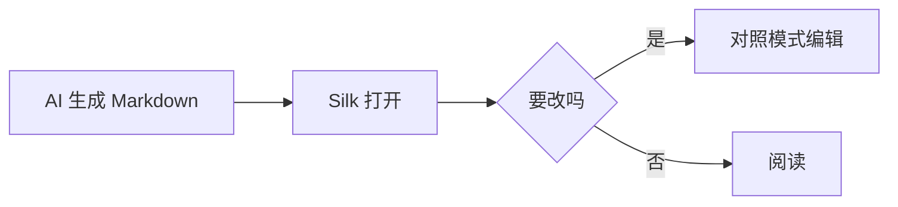

# Silk 格式样例

这份文档覆盖 Silk 能识别的格式，用来检查渲染和滚动对照。**粗体**、*斜体*、~~删除线~~、==高亮==、`行内代码`、<kbd>⌘</kbd> + <kbd>O</kbd>，自动链接 https://www.apple.com。

## 提示块

> [!NOTE]
> GitHub 风格的提示块。

> [!TIP]
> 用 ⇧⌘O 快速打开文件。

> [!WARNING]
> 这是一条警告。

> [!caution]- Obsidian 风格，可折叠，带自定义标题
> 折叠起来的内容。

## 任务列表

- [x] 打开文件夹
- [x] 渲染 Markdown
- [ ] Quick Look 插件

## 表格

| 功能 | 快捷键 | 状态 |
| --- | :---: | ---: |
| 阅读 | ⌘1 | ✅ |
| 对照 | ⌘2 | ✅ |
| 源码 | ⌘3 | ✅ |

## 代码

```swift title=Hello.swift
import AppKit

let greeting = "Hello, Silk"
print(greeting)
```

```ts:src/render.ts
export function render(text: string): string {
  return text.trim();
}
```

## 数学公式

美元符号写法：$E = mc^2$，以及 ChatGPT 常用的括号写法：\(a^2 + b^2 = c^2\)。

$$
\int_0^1 x^2 \, dx = \frac{1}{3}
$$

\[
\sum_{n=1}^{\infty} \frac{1}{n^2} = \frac{\pi^2}{6}
\]

## Mermaid



## 双链与脚注

参见 [[README]] 或 [[README|项目说明]]。这里有一个脚注[^1]。

[^1]: 脚注内容在文末。

## 折叠

<details>
<summary>点开看看</summary>

折叠里的 **Markdown** 也会渲染。

</details>

## 引用

> 普通引用块。
> 第二行。

---

完。
